# Lab 01: Basic Configuration and Hardening of a Cisco and a MikroTik Router.

## 1. Description

This lab covers the initial configuration and security hardening of Cisco IOS and MikroTik RouterOS devices in a simulated network environment using the Graphical Network Simulator (GNS3).
It focuses on configuring device identities and IP addresses, securing admin access, enabling SSH, disabling unnecssary services etc.

## 2. Background

Network infrastructure devices (routers, firewalls, switches) are among the assets of an enterprise that play a major role in security and therefore need to be protected and configured and protected accordingly.
A compromised router can be devastating to the whole security of an organisation since it can be used to gain access to data, reconfigured to route traffic to other destinations etc.
Therefore hardening the network devices themselves is essential for enhancing the whole security of the enterprise.

Both Cisco IOS and MikroTik RouterOS provider user management, SSH, access control lists and firewall filtering rules etc.  
This lab aims to apply these controls in an isolated GNS topology to secure the management plane and allow only authorized legitimate administrators to gain management access, while denying all others.

## 3. Objectives

By the end of this lab you will have:

- To configure device identities and IP addresses on Cisco IOS and MikroTik RouterOS.
- To configure local administrative authentication and SSH access.
- To restrict SSH management access to an authorized adminstration host.
- To disable unnecssary management services and discovery mechanisms where appropriate.
- To implement and verify management access to both platforms.
- To compare the configuration and verification procedurs used by the two platforms.
- To evaluate the effectiveness of the implemented access controls.

## 4. Topology and addressing

The network contains two routers, two Ethernet switches and two Linux Hosts. One Ethernet segement is reserved for trusted management traffic, while the other is used to simulate an untrusted network.  
The adminstration host connects to the management segement. The test host connects to the untrusted segment. Both routers have interfaces connected to each segment.

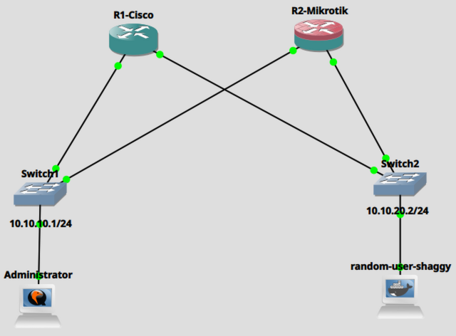

**Devices**

| Device             | Role                  | Vendor / Image                                  | Version               |
| ------------------ | --------------------- | ----------------------------------------------- | --------------------- |
| R1                 | Router                | Cisco c7200-adventerprisek9-mz.153-3.XB12.image | 15.3(3)XB12           |
| R2                 | Router                | MikroTik CHR                                    | 7.22.1                |
| Switch1            | Management LAN switch | GNS3 Ethernet Switch                            | N/A                   |
| Switch2            | Untrusted LAN switch  | GNS3 Ethernet Switch                            | N/A                   |
| Administrator      | Admin host            | Kali Linux - QEMU Hosted                        | 6.16.8+kali-amd64     |
| random-user-shaggy | Unauthorized User     | Kali Linux - Docker Hosted                      | 7.2.9-200.fc44.x86_64 |

**Addressing**

| Device             | Interface | IP address / mask | Connected to | Notes                      |
| ------------------ | --------- | ----------------- | ------------ | -------------------------- |
| R1                 | fa0/0     | 10.10.10.1/24     | Switch1      | Management interface       |
| R1                 | fa1/0     | 10.10.20.1/24     | Switch2      | Untrusted facing interface |
| R2                 | ether1    | 10.10.10.2/24     | Switch1      | Management interface       |
| R2                 | ether2    | 10.10.20.2/24     | Switch2      | Untrusted facing interface |
| Administrator      | eth0      | 10.10.10.10/24    | Switch1      | Authorized administrator   |
| random-user-shaggy | eth0      | 10.10.20.10/24    | Switch2      | Untrusted user             |

**VLAN TABLE**  
The GNS3 Ethernet switches provide separate Layer 2 segments. VLAN configuration is outside the scope of this lab.

## 6. Prerequisites

- Basic understanding of IPv4 addresssing and subnet masks.
- Familiarity with router interfaces and command line configurations.
- Basic understanding of SSH and user authentication.
- A working GNS3 installation. For more information on how to setup GNS3 see [this guide](../../misc/gns3-guide/GNS3_GUIDE.md).

## 7. Setup

- Download the project file [here](https://github.com/kakeetopius/networking-labs/releases/download/v0.0.1/01-basic-configuration-and-hardening.gns3project)
- Import the file into GNS3. Find more information on using GNS3 using [this](../../misc/gns3-guide/GNS3_GUIDE.md) guide.

## 8. Walkthrough

## 8.1 Cisco IOS Configuration.

### 1. Initial device configuration.

**Purpose:** Establish the device identity, configure network interfaces, and assign IP addresses.

The commands below set a hostname for the router and assign ip addresses to the router interfaces as shown in the table in Section 4.

```
R1-Cisco(config)#hostname R1-Cisco
R1-Cisco(config)#interface fa0/0
R1-Cisco(config-if)#ip address 10.10.10.1 255.255.255.0
R1-Cisco(config-if)#no shutdown
R1-Cisco(config-if)#exit

R1-Cisco(config)#interface fa1/0
R1-Cisco(config-if)#ip address 10.10.20.1 255.255.255.0
R1-Cisco(config-if)#no shutdown
R1-Cisco(config-if)#exit
R1-Cisco(config)#
```

Verification:  
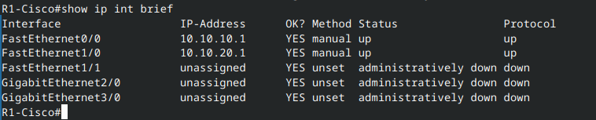

### 2. Create an enable secret password and encrypt passwords on the device.

**Purpose:**
An enable secret password grants privileged adminstrative access to the IOS device. For better security a password of at least 10 characters mixed with alphanumeric and special symbols is recommended.

By default all passwords configured on the Cisco device are shown as clear text in the configuration file. In order to encrypt the clear text passwords and obscure them from showing in the configuration file, they should be encrypted with the command illustrated below.  
In reality the password encryption uses a fairly weak cipher (Vigenre cipher) which can be decrypted with software tools. But it can protect against shoulder surfers.

```
R1-Cisco(config)#enable secret myenpassword.12345@$
R1-Cisco(config)#service password-encryption
R1-Cisco(config)#exit
```

Verification:  
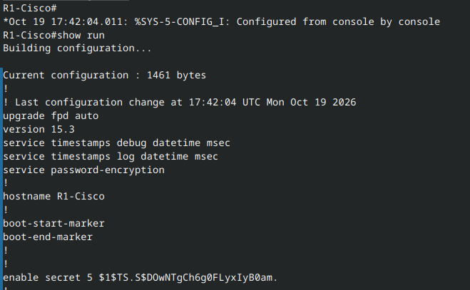

### 3. Secure adminstrative access with SSH.

**Purpose:** Provide secure, encrypted and authenticated remote management adminstrative access.

3.1 Configure the required SSH prerequisites.

```
R1-Cisco(config)#ip domain-name netsec.org
R1-Cisco(config)#crypto key generate rsa general-keys modulus 2048
R1-Cisco(config)#ip ssh version 2
```

The above configuration ensures ssh uses a stronger 2048-bit key and forces the device to only SSHv2 and disables the older insecure SSHv1.

3.2 Limit SSH authentication retries to only 3 to prevent brute force attacks, and set the ssh timeout to 60 seconds after which the device will disconnect if the ssh session is idle.

```
R1-Cisco(config)#ip ssh authentication-retries 3
R1-Cisco(config)#ip ssh time-out 60
```

3.3 Configure the vty lines to use ssh only and disable telnet which transports all data in plaintext. In addition, configure ssh to use the local user database to authenticate users.

```
R1-Cisco(config)#line vty 0 15
R1-Cisco(config-line)#transport input ssh
R1-Cisco(config-line)#login local
R1-Cisco(config-line)#exit
```

3.4 Configure a local user with adminstrative privileges.

```
R1-Cisco#conf t
R1-Cisco(config)#username pius privilege 15 secret adminPass12345@$
R1-Cisco(config)#
```

SSH Verification:  
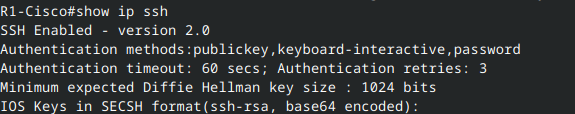

Local User Verification:  
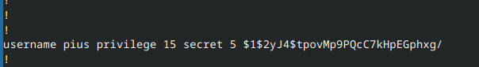

### 4. Restrict management access.

**Purpose:** Allow management access only from the authorized adminstration host.  
Only the adminstration host whose ip address is 10.0.10.10 should be able to gain vty access via SSH on the network.

4.1 Create a simple standard Access Control List (ACL) that matches the IP address 10.0.10.10

```
R1-Cisco(config)#ip access-list standard SSH-ACCESS
R1-Cisco(config-std-nacl)#permit host 10.10.10.10
R1-Cisco(config-std-nacl)#exit
```

4.2 Apply the ACL on the vty to restrict access to only IP addresses matched by the ACL.

```
R1-Cisco(config)#line vty 0 15
R1-Cisco(config-line)#access-class SSH-ACCESS in
R1-Cisco(config-line)#exit
```

Verification of the effectiveness of the restrictions of the ACLs is shown [later](#6-verifying-the-hardening-configuration) or in the lab.

### 5. Disable unnecssary services and swich off all unusued ports.

**Purpose:** To reduce the device's attack surface by disabling management services and features which are not required for now and adminstratively shutting down all unused router ports.

5.1 Shutdown unused ports.

```
R1-Cisco(config)#int range fa1/1,gig2/0,gig3/0
R1-Cisco(config-if-range)#shutdown
R1-Cisco(config-if-range)#exit
```

Verification:  
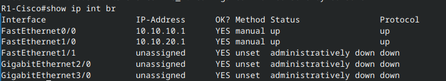

5.2 Disable CDP on user facing or untrusted ports. This prevents devices/hosts from gaining access to information about the device.

```
R1-Cisco(config)#int range fa1/1,gig2/0,gig3/0
R1-Cisco(config-if-range)#no cdp enable
R1-Cisco(config-if-range)#exit
```

5.3 Disable the internal http server. HTTP transports data without encryption so it is susceptible to eavesdropping.

```
R1-Cisco#conf t
R1-Cisco(config)#no ip http server
R1-Cisco(config)#exit
```

Verification:  
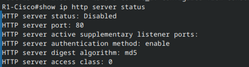

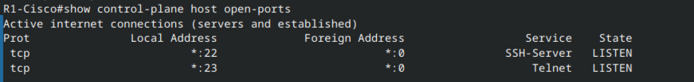

### 6. Verifying the hardening configuration.

The admin 'pius' can successfully access the router via SSH.  
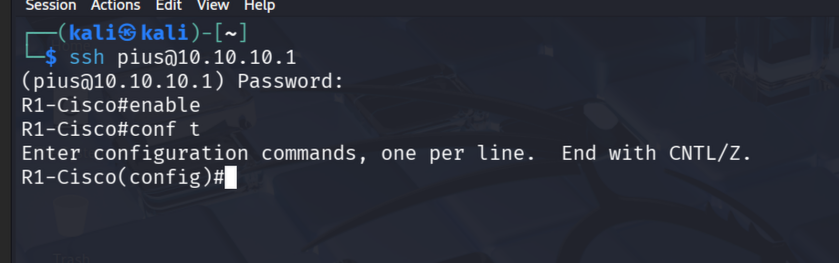

The random-user-shaggy is denied access to the router via SSH.  
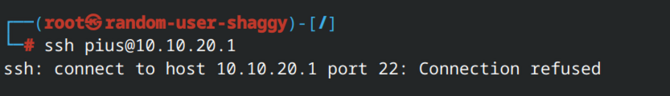

## 8.2 Mikrotik RouterOS Configuration.

### 1. Initial device configuration.

**Purpose:** To Establish the device identity, configure network interfaces, and assign IP addresses.  
Configure the hostname

```
[admin@MikroTik] > /system identity set name=R2-Mikrotik
[admin@R2-Mikrotik] >
```

Configure ip addresses as shown in Section 4.

```
[admin@R2-Mikrotik] > /ip address add interface=ether1 address=10.10.10.2/24
[admin@R2-Mikrotik] > /ip address add interface=ether2 address=10.10.20.2/24
```

Verification of the ip address.  
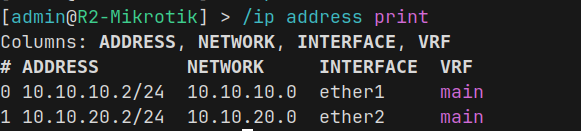

### 2. Secure User Accounts.

**Purpose:** To disable the default admin user and create a new user and give them the required privileges.

Create a new user.

```
[admin@R2-Mikrotik] > /user/add name=pius password=adminPass12345@# group=full
```

Disable the default admin account.

```
[admin@R2-Mikrotik] > /user/remove admin
```

Verification of users on the system and their roles.  
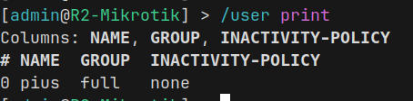

### 3. Secure adminstration access using SSH.

**Purpose:** To allow the newly created administrator to gain access to the router using SSH and the strongest possible SSH authentication which is public key authentication.

Generate the SSH key pair on the administrator computer that will be used to connect to router.  
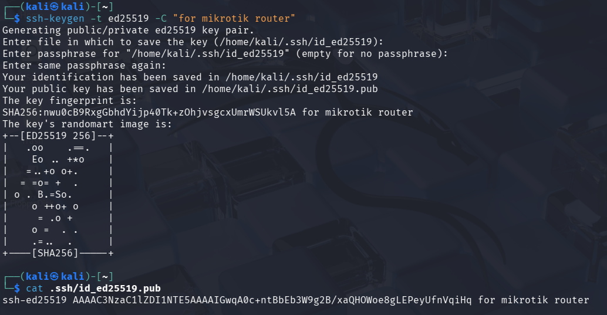  
It is important to use the keytype `ed25519` because it provides higher security and faster performance with significantly smaller key sizes than RSA.

Copy the public key of the newly created key pair to the Mikrotik router.
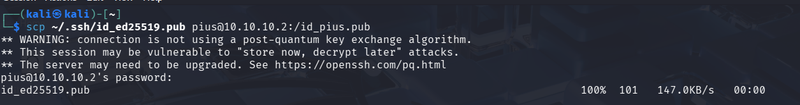

Verify that the key was copied to the router.  
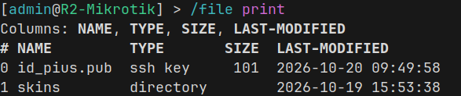

Associate the uploaded public key with the user 'pius' to enable the user to login without a passowrd.

```
[pius@R2-Mikrotik] > /user ssh-keys import public-key-file=id_pius.pub user=pius
```

Verify the key was imported.  
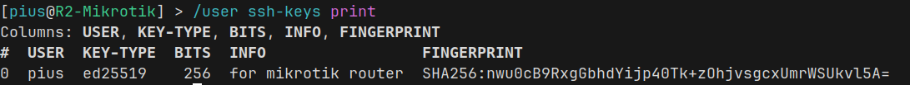

Completely disable passowrd based SSH authentication to eliminate the risk of brute-force and credential guessing attacks and force the router to disable the use of weak cryptographic protocols.

```
[admin@R2-Mikrotik] > /ip ssh set password-authentication=no
[admin@R2-Mikrotik] > /ip ssh set strong-crypto=yes
```

Restrict SSH access to the router from a only the adminstrator subnet.

```
[pius@R2-Mikrotik] > /ip service set ssh address=10.10.10.0/24
```

Verify that the admin user 'pius' can login with public key authentication without a password.  
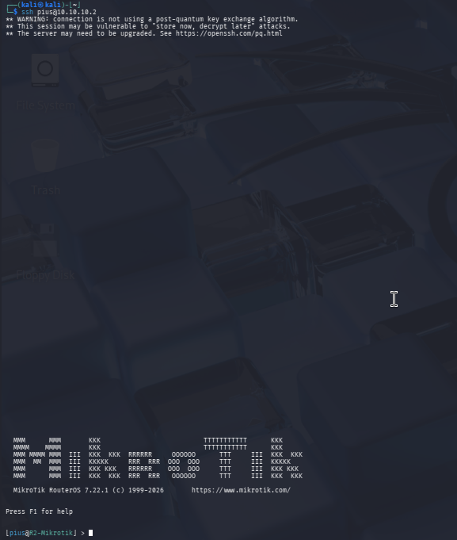

Verify that the user random-user-shaggy cannot gain ssh access.  
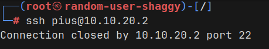

### 4. Disable unnecssary services.

**Purpose:** To reduce the device's attack surface by disabling services and features thar are not required.

Below are the services enabled by default on the router.  
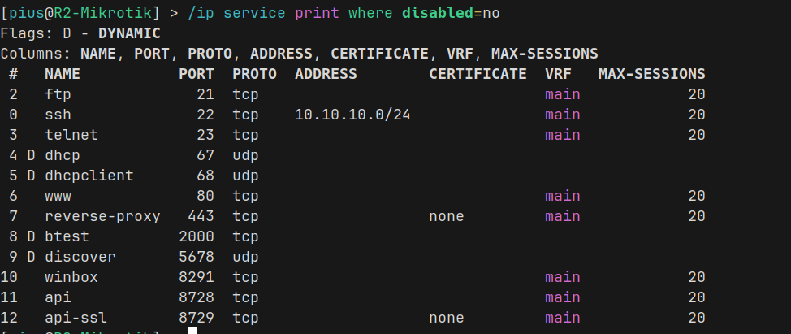

Disable all unnecssary services.

```
[pius@R2-Mikrotik] > /ip service
[pius@R2-Mikrotik] /ip/service> set telnet disabled=yes
[pius@R2-Mikrotik] /ip/service> set ftp disabled=yes
[pius@R2-Mikrotik] /ip/service> set www disabled=yes
[pius@R2-Mikrotik] /ip/service> set api disabled=yes
[pius@R2-Mikrotik] /ip/service> set api-ssl disabled=yes
[pius@R2-Mikrotik] /ip/service> set winbox disabled=yes
```

## 9. Key Takeaways.

- Device hardening begins with secure adminstrative access and disabling unnecssary services.
- SSH provides encrypted remote management but must be combined with appropriate authentication and access restrictions to strengthen the security position.
- Cisco IOS and MikroTik RouterOS implement similar security goals using different configuration mechanisms.

## 10. References.

- [MikroTik RouterOS Official Documentation](https://manual.mikrotik.com/docs/introduction)
- [Cisco Configuration Guide](https://www.cisco.com/c/en/us/td/docs/routers/access/800M/software/800MSCG/routconf.html)
